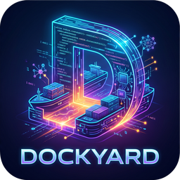

<p align="center">
  
</p>

[English](README.md) · **Italiano**

# Dockyard

[](https://github.com/giurlanda/dockyard/actions/workflows/ci.yml)
[](https://github.com/giurlanda/dockyard/tags)
[](LICENSE)
[](pyproject.toml)
[](https://github.com/giurlanda/dockyard/pkgs/container/dockyard)
[](https://github.com/astral-sh/ruff)
[](https://mypy-lang.org/)

Dockyard è un'applicazione web self-hosted e multi-utente che trasforma un repository GitHub o
GitLab in un Progetto: un ambiente isolato in cui Claude lavora sul codice, sempre raggiungibile
dall'app Claude sul telefono o da un browser. Ogni Utente collega il proprio abbonamento claude.ai;
i Progetti raggiungono internet ma non la tua LAN, l'host o gli altri Progetti.

Dockyard è un progetto open source indipendente. Non è realizzato né approvato da Anthropic.

## Prima di iniziare

Ti servono:

- **Una macchina Linux con Docker** (Docker Engine con il plugin compose) e `systemd`, per il
  firewall dell'host. Il riferimento è Ubuntu 24.04. Sono pubblicate sia amd64 sia arm64.
- **Almeno un modo di accesso**, e puoi averli entrambi:
  - **Cloudflare**, per raggiungere Dockyard da ovunque: un dominio su Cloudflare e un account
    Cloudflare Zero Trust (basta il piano gratuito). Dockyard non pubblica alcuna porta per
    questo: le persone entrano attraverso un Cloudflare Tunnel, dopo che Cloudflare Access ha
    verificato chi sono.
  - **Accesso locale**, per raggiungere Dockyard dalla tua LAN o VPN senza Cloudflare: la pagina
    di accesso di Dockyard, con email, password e un Secondo fattore facoltativo, in HTTPS su una
    porta che l'host pubblica solo sull'indirizzo IPv4 che indichi. Accetta solo le Reti locali,
    mai internet e mai il tunnel.
- **Un abbonamento claude.ai per ogni Utente: Pro, Max, Team o Enterprise.** I Progetti eseguono
  Claude con Remote Control, che funziona solo con un abbonamento claude.ai. Le API key e i token
  di lunga durata (come quello creato con `claude setup-token`) lo disattivano. Su un piano Team o
  Enterprise, un Owner deve prima abilitare Remote Control per l'organizzazione.

## Installazione

### 1. Scarica i file

```sh
sudo git clone https://github.com/giurlanda/dockyard.git /opt/dockyard
sudo chown -R "$USER" /opt/dockyard
cd /opt/dockyard
cp .env.example .env
```

Dockyard gira da immagini pubblicate; il repository ti fornisce solo `compose.yaml`,
`compose.cloudflare.yaml`, `compose.local.yaml`, `.env.example` e il firewall dell'host in `host/`.
Tienilo in `/opt/dockyard`: il servizio del firewall legge le sue impostazioni da `/opt/dockyard/.env`.

### 2. Scegli i modi di accesso

La riga `COMPOSE_FILE` di `.env` li sceglie: i file compose che Docker usa.

| Installazione | `COMPOSE_FILE` | Passi |
| --- | --- | --- |
| Solo Cloudflare (predefinita) | `compose.yaml:compose.cloudflare.yaml` | 3, 4 |
| Solo Accesso locale | `compose.yaml:compose.local.yaml` | 5 |
| Entrambi | `compose.yaml:compose.cloudflare.yaml:compose.local.yaml` | 3, 4, 5 |

Segui i passi della tua installazione, poi prosegui dal passo 6. Senza Cloudflare, lascia vuote
le sue tre impostazioni in `.env`; Dockyard si rifiuta di partire se nessun modo di accesso è
configurato.

### 3. Crea il Cloudflare Tunnel

Nella dashboard di Cloudflare, apri **Zero Trust → Networks → Tunnels**:

1. **Create a tunnel**, di tipo **Cloudflared**, e dagli un nome (ad es. `dockyard`).
2. Nella pagina di installazione, copia il token: il valore lungo dopo `--token` in uno qualsiasi
   dei comandi di installazione. Mettilo in `.env` come `DOCKYARD_CF_TUNNEL_TOKEN`. Non eseguire
   il comando di installazione: `compose.cloudflare.yaml` avvia già il client del tunnel.
3. Aggiungi un **public hostname** (una *published application route* nelle dashboard più
   recenti), ad es. `dockyard.example.com`, con tipo di servizio **HTTP** e URL
   **`dockyard:8000`**.

### 4. Proteggilo con Cloudflare Access

Sempre in Zero Trust, apri **Access → Applications → Add an application → Self-hosted**:

1. Usa lo stesso hostname del tunnel (`dockyard.example.com`).
2. Aggiungi una policy con azione **Allow** che includa le email (o il dominio email) delle
   persone che useranno Dockyard. Access le lascia passare; Dockyard ammette comunque solo le
   persone invitate da un Amministratore.
3. Salva, poi apri la **Overview** dell'applicazione e copia l'**Application Audience (AUD) Tag**
   in `.env` come `DOCKYARD_CF_ACCESS_AUD`.
4. Metti il nome del tuo team in `DOCKYARD_CF_ACCESS_TEAM`: l'`acme` del dominio del team
   `acme.cloudflareaccess.com` (lo trovi in **Settings → Custom pages**, oppure nella barra degli
   indirizzi della pagina di login di Access).

Dockyard verifica il token che Cloudflare Access aggiunge a ogni richiesta e WebSocket:
raggiungere Dockyard in qualsiasi altro modo non dà accesso a nulla.

### 5. Configura l'Accesso locale

Metti in `.env` come `DOCKYARD_LOCAL_ADDRESS` l'indirizzo IPv4 dell'host sulla tua LAN, ad es.
`192.168.1.10` (`ip -4 addr` li elenca). La pagina di accesso risponde solo lì, sulla porta 8443
(`DOCKYARD_LOCAL_HOST_PORT` la cambia), e mai su IPv6. Dai all'host un indirizzo fisso (statico,
o una prenotazione sul router): Docker non può avviare Dockyard se l'indirizzo manca.

`.env.example` spiega le impostazioni facoltative: le Reti locali da cui le persone possono
accedere (`DOCKYARD_LOCAL_NETWORKS`, per impostazione predefinita le reti private e la rete di
Tailscale) e l'indirizzo a cui puntano i Link di attivazione (`DOCKYARD_LOCAL_URL`, ad es.
`https://dockyard.lan:8443`).

Per pubblicare la pagina di accesso anche su un altro indirizzo, ad es. quello Tailscale
dell'host, crea `compose.override.yaml` accanto a `compose.yaml`:

```yaml
services:
  dockyard:
    ports:
      - "100.101.102.103:${DOCKYARD_LOCAL_HOST_PORT:-8443}:8443"
```

e aggiungilo in fondo a `COMPOSE_FILE` in `.env`:
`COMPOSE_FILE=compose.yaml:compose.local.yaml:compose.override.yaml` (con `compose.cloudflare.yaml`
anche, se usi Cloudflare). Con `COMPOSE_FILE` impostato, Docker non legge `compose.override.yaml`
da solo.

### 6. Completa il resto di `.env`

```sh
openssl rand -base64 32 | tr '+/' '-_'
```

- `DOCKYARD_SECRET_KEY`: il valore stampato sopra. Cifra le Credenziali Git e i Secondi fattori
  salvati in Dockyard; conservane una copia in un posto sicuro, perché un'Istanza ripristinata ha
  bisogno della stessa chiave.
- `DOCKYARD_FIRST_ADMINISTRATOR_EMAIL`: la tua email, quella con cui accedi tramite Cloudflare
  Access o con l'Accesso locale.

`.env.example` spiega le impostazioni facoltative: i Limiti dell'Istanza (CPU e RAM per Progetto,
Progetti attivi per Utente), i server DNS usati dai Progetti, gli indirizzi LAN che i Progetti
possono raggiungere e la release di Dockyard da eseguire (`DOCKYARD_VERSION`, predefinito
`latest`).

### 7. Avvia Dockyard

```sh
docker compose up -d
docker compose logs -f dockyard
```

Dockyard si rifiuta di partire finché ogni impostazione obbligatoria non è compilata, e il suo log
indica quale manca. All'avvio crea la rete dei Progetti (bridge `dockyard0`) se non esiste, e
scrive nel log quali modi di accesso sono attivi: `Cloudflare Access: on`, `Local sign-in: on,
port 8443, published on 192.168.1.10`.

Con l'Accesso locale, Dockyard scrive nel log anche il certificato della sua pagina di accesso e
la sua impronta: `Local sign-in certificate (self-signed), SHA-256 fingerprint: AB:CD:…`. Se non
ne fornisci uno, Dockyard crea un certificato autofirmato al primo avvio e lo conserva nel suo
volume dei dati, tra riavvii e aggiornamenti. I browser lo segnalano: prima di proseguire,
verifica che l'impronta SHA-256 che il browser mostra per il certificato sia quella del log. Per
usare un tuo certificato, copialo con la sua chiave (PEM, la chiave senza passphrase) nel volume
dei dati e riavvia:

```sh
docker compose exec -T dockyard sh -c 'mkdir -p /data/tls && cat > /data/tls/cert.pem' < cert.pem
docker compose exec -T dockyard sh -c 'cat > /data/tls/key.pem' < key.pem
docker compose restart dockyard
```

### 8. Installa il firewall dell'host

Fallo dopo che Dockyard è partito, così la rete dei Progetti esiste già:

```sh
sudo install -m 755 host/dockyard-firewall.sh /usr/local/sbin/dockyard-firewall
sudo install -m 644 host/dockyard-firewall.service /etc/systemd/system/
sudo systemctl daemon-reload && sudo systemctl enable --now dockyard-firewall
```

Da quel momento i Progetti raggiungono internet ma non le reti private (10/8, 172.16/12,
192.168/16, 169.254/16, 100.64/10) né l'host. Il servizio applica le regole all'avvio della
macchina e ogni volta che Docker parte, così i Progetti non girano mai senza.

Per permettere ai Progetti di raggiungere un servizio specifico della tua LAN, elenca il suo
indirizzo o la sua rete in `.env` (`DOCKYARD_ALLOWED_IPS=192.168.1.50,10.0.5.0/24`), poi
`sudo systemctl restart dockyard-firewall`.

Per verificare: nel Terminale di un Progetto, `curl -m 3 http://192.168.1.1` (il tuo router) deve
fallire e `curl -I https://github.com` deve riuscire.

### 9. Accedi come primo Amministratore

**Tramite Cloudflare**: apri `https://dockyard.example.com`. Cloudflare Access ti chiede chi sei;
con l'email indicata in `DOCKYARD_FIRST_ADMINISTRATOR_EMAIL` arrivi alla tua dashboard come
Amministratore.

**Con l'Accesso locale**: prima datti una password. Il comando la chiede due volte, senza
mostrarla, così non finisce mai in `.env` né nella cronologia della shell; deve essere lunga
almeno 12 caratteri e diversa dalla tua email:

```sh
docker compose exec dockyard python -m dockyard set-password tu@example.com
```

Poi apri `https://192.168.1.10:8443` da un dispositivo della tua LAN e accedi. Lo stesso comando
funziona per qualsiasi Utente, come reset di emergenza: lo disconnette ovunque. Per un Utente che
ha perso sia il telefono con il suo Secondo fattore sia i codici di recupero,
`docker compose exec dockyard python -m dockyard remove-second-factor <email>` lo rimuove.

Dalla tua dashboard:

1. **Collega il tuo Account Claude** con il tuo abbonamento claude.ai: Dockyard apre un terminale
   in cui apri il link di accesso e incolli il codice.
2. **Invita** le altre persone in **Utenti**, con la loro email. Tramite Cloudflare, devono essere
   ammesse anche dalla policy di Access. Con l'Accesso locale, ogni Invito ha un Link di
   attivazione, valido 7 giorni e una sola volta, che copi dalla pagina Utenti: la persona lo apre
   sulla LAN e sceglie la sua password. Dockyard non invia alcun messaggio: comunica tu
   l'indirizzo, e il link. Un Link di attivazione è sicuro solo quanto il canale con cui lo
   consegni.
3. Crea un Progetto dall'URL di un repository. Compare nell'app Claude (scheda Code) con il nome
   che gli hai dato.

### 10. Verifica che la pagina di accesso non sia raggiungibile dall'esterno

Con l'Accesso locale, verifica dove Docker pubblica la porta e che nient'altro risponda:

1. Sull'host, `docker compose ps dockyard` deve elencare sotto PORTS solo gli indirizzi che hai
   indicato (`192.168.1.10:8443->8443/tcp`), mai `0.0.0.0` o `[::]`.
2. Da un dispositivo fuori dalle tue reti, ad es. un telefono in rete mobile e fuori dalla VPN,
   `https://<indirizzo pubblico dell'host>:8443` non deve aprirsi. Se l'host ha un indirizzo
   IPv6, anche `curl -k -m 5 "https://[<quell'indirizzo>]:8443"` deve fallire.
3. Da un dispositivo della LAN, `https://192.168.1.10:8443` mostra la pagina di accesso.

Dockyard controlla anche il client: una richiesta sulla porta locale da fuori le Reti locali, o
dalle reti di Docker stesso, riceve una pagina di rifiuto che non rivela nulla dell'Istanza.

## Aggiornamento

**Un'Istanza installata prima dell'Accesso locale deve prima aggiungere questa riga a `.env`**,
altrimenti il tunnel non parte più e Cloudflare smette di funzionare:

```sh
COMPOSE_FILE=compose.yaml:compose.cloudflare.yaml
```

Poi esegui `git pull`, perché questa release modifica `compose.yaml` e `.env.example` e aggiunge
`compose.cloudflare.yaml`, e aggiorna come al solito:

```sh
cd /opt/dockyard
docker compose pull
docker compose up -d
```

`docker compose pull` scarica l'immagine Dockyard e l'Immagine base più recenti della tua release.
L'Immagine base viene ricostruita ogni settimana, così il Claude Code che contiene resta
aggiornato: quando ne arriva una più recente, Dockyard ricostruisce tutte le Immagini
dell'Istanza, e ogni Progetto mostra "Aggiornamento disponibile" e passa alla nuova al successivo
riavvio. Solo l'ultima release riceve questa ricostruzione settimanale: un'Istanza fissata a una
release precedente con `DOCKYARD_VERSION` mantiene il Claude Code scaricato l'ultima volta.

Quando una release modifica i file compose, `.env.example` o il firewall dell'host, le sue note lo
indicano: esegui prima `git pull`, poi reinstalla il firewall come al passo 8 se è cambiato.

## Backup

Dockyard non fa il backup di se stesso. Tutto risiede in volumi Docker: `dockyard_dockyard-data`
(Utenti, Inviti, Credenziali Git, Immagini, Progetti) e, per ogni Progetto e Utente, i volumi di
codice, home e Account Claude. Esegui il backup con i tuoi strumenti abituali, insieme a `.env`.

## Sviluppo

```sh
uv sync && uv run playwright install chromium
uv run pytest tests/api tests/e2e          # Seam A e C: Runtime in memoria, Docker non necessario
uv run pytest tests/runtime                # Seam B: il contratto del Runtime, anche contro Docker
sudo DOCKYARD_FIREWALL_TESTS=1 DOCKYARD_LOCAL_PORT_TESTS=1 .venv/bin/pytest tests/host  # Host: root, Linux
docker compose -f compose.yaml -f compose.dev.yaml up -d --build   # esegue questo checkout
```

Un tag di versione (`git tag v1.2.3 && git push --tags`) pubblica l'immagine Dockyard e
l'Immagine base su GHCR una volta superata la CI; il workflow Release ricostruisce inoltre
l'Immagine base dell'ultima release ogni lunedì (GitHub disattiva i workflow pianificati dopo 60
giorni senza attività nel repository; riattivalo dalla scheda Actions).

## Licenza

Apache License 2.0: vedi [LICENSE](LICENSE).
