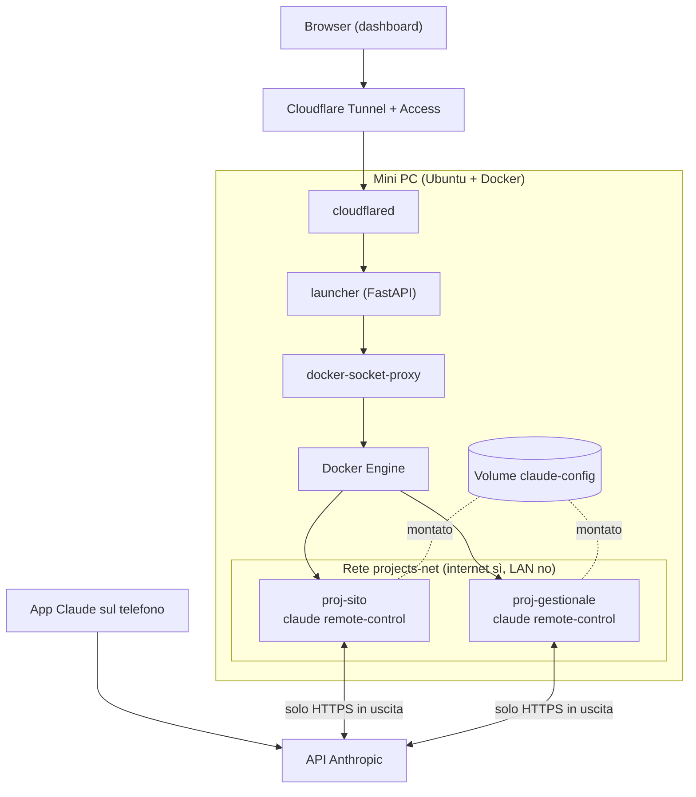

# Claude Code Launcher – Design

Oct 14, 2026 · @Francesco Giurlanda

## Obiettivo e requisiti

Una web app Python sul mini PC che, data una URL GitHub o GitLab, clona il repository e avvia un container dedicato con `claude remote-control`, controllabile dall'app Claude sul telefono.

| Area | Decisione |
| --- | --- |
| Utenti | Uno solo (il proprietario) |
| Accesso | Da internet tramite Cloudflare Tunnel + Cloudflare Access |
| Repository | GitHub, gitlab.com e GitLab self-hosted; pubblici senza credenziali, privati con token in sola lettura |
| Login Claude | Fatto una volta dall'interfaccia web, config condivisa con tutti i container |
| Immagine progetto | Un'immagine base unica (Ubuntu + Claude Code + git, Node, Python) |
| Push | Nessun push automatico: lo fa l'utente dal terminale web |
| Permessi Claude | Modalità scelta per progetto alla creazione |
| Rete progetti | Internet libero, LAN dell'ufficio bloccata |
| Dashboard | Stop/riavvio/elimina, log e stato live, terminale web, limiti CPU/RAM |
| Anteprima dev server | Esclusa dalla prima versione |
| Stack | Python (FastAPI + Docker SDK) |

## Architettura

Sul mini PC girano quattro servizi fissi (cloudflared, launcher, socket proxy, Docker) più un container per ogni progetto; l'unico componente da sviluppare è il launcher.

Nessuna porta è aperta in ingresso: la dashboard arriva da Cloudflare, le sessioni passano dall'API Anthropic. I container di progetto escono su internet ma non vedono la LAN, la dashboard né il socket proxy.

## Flussi principali

Tre flussi coprono l'MVP: login Claude una tantum, creazione di un progetto e gestione quotidiana.

### 1. Login Claude (una volta, o quando scade)

1. Dalla dashboard premi "Collega account Claude".
2. La web app crea un container temporaneo dall'immagine base, con il volume `claude-config` montato e `CLAUDE_CONFIG_DIR` impostato.
3. Nel container gira `claude auth login`; il terminale viene mostrato nel browser (xterm.js su WebSocket, collegato a `docker exec`/attach).
4. Apri il link di login sul browser, poi incolli il codice nel terminale (il callback su localhost non raggiunge il container).
5. A login riuscito il container si chiude; il volume contiene credenziali, `.claude.json` e impostazioni.
6. Dallo stesso terminale accetti la conferma iniziale di Remote Control (`claude remote-control` una volta, poi Ctrl+C).

### 2. Creazione di un progetto

1. Inserisci URL, nome, token (se privato), modalità permessi, limiti CPU/RAM.
2. La web app valida l'URL (solo `https://github.com/…` o `https://gitlab.com/…` o un GitLab self-hosted elencato in ALLOWED\_GIT\_HOSTS, anche con porta personalizzata).
3. Crea il volume `proj-<id>-workspace` e clona il repo con un container `git` effimero; per i repo privati il token passa come variabile d'ambiente al solo clone.
4. Riscrive il remote `origin` senza token, così il container di progetto non lo vede.
5. Avvia il container `proj-<id>` con workspace e config montati, rete `projects-net`, limiti risorse, comando `claude remote-control --name "<nome>" --spawn worktree --permission-mode <modo>`.
6. Al primo avvio della cartella il prompt di trust va confermato: la web app lo fa dal terminale web oppure pre-registra il trust (da verificare, vedi Rischi).
7. La sessione appare nell'app Claude, tab Code, con il nome del progetto.

### 3. Gestione quotidiana

- **Stato e log**: la dashboard legge `docker ps` filtrato per etichetta `launcher.project=<id>`, lo stream dei log e le statistiche CPU/RAM.
- **Stop / riavvio**: azioni dirette sul container; le sessioni restano riprendibili per circa 4 ore con `--continue`.
- **Elimina**: rimuove il container e, solo con conferma esplicita, il volume del codice.
- **Terminale web**: `docker exec` di una shell come utente non-root; da qui fai `git push` inserendo il token al momento.

## Sicurezza

Il rischio principale è l'accesso a Docker: chi controlla la web app controlla di fatto il mini PC. Le difese sono a strati.

| Livello | Misura |
| --- | --- |
| Ingresso | Cloudflare Tunnel (nessuna porta aperta) + Cloudflare Access limitato alla tua email, con sessione breve |
| Web app | Verifica del JWT `Cf-Access-Jwt-Assertion` su ogni richiesta e WebSocket (audience e chiavi pubbliche del team Access) |
| Docker | Nessun `docker.sock` nella web app: solo `docker-socket-proxy` con `CONTAINERS`, `IMAGES`, `VOLUMES`, `NETWORKS`, `EXEC`, `POST` abilitati; il resto bloccato |
| Container creati | Solo dall'immagine base; nessun bind mount dell'host, niente `privileged`, `cap_drop: ALL` + capacità minime, `no-new-privileges`, utente non-root |
| Token Git | Cifrati nel DB con Fernet (chiave in variabile d'ambiente); usati solo dal container di clone, mai salvati nel remote |
| Rete progetti | Rete bridge `projects-net` con regole iptables (catena `DOCKER-USER`) che bloccano 10.0.0.0/8, 172.16.0.0/12, 192.168.0.0/16 tranne il gateway DNS |
| Credenziali Claude | Il volume `claude-config` è leggibile da ogni progetto: un repo malevolo con permessi ampi potrebbe sottrarlo. Usa la modalità bypass solo su repo fidati |
| Input | URL validata con regex e host in allowlist; nomi container generati dall'app, mai dall'input |

La web app stessa non è nella rete `projects-net`: i progetti non possono raggiungere né la dashboard né il socket proxy.

## Modello dati e API

Lo stato vive in un file SQLite su volume; lo stato dei container si legge sempre da Docker, non si duplica nel DB.

**Tabella `projects`**

| Campo | Tipo | Note |
| --- | --- | --- |
| id | text (slug + 6 caratteri casuali) | usato nei nomi di container e volumi |
| name | text | nome della sessione Remote Control |
| repo\_url | text | URL validata |
| provider | text | `github` o `gitlab` |
| token\_enc | blob, nullable | token cifrato, solo per repo privati |
| permission\_mode | text | `default`, `acceptEdits`, `auto`, `bypassPermissions` |
| cpu\_limit | real | core massimi |
| mem\_limit\_mb | integer | RAM massima |
| created\_at | datetime |  |

**Endpoint (FastAPI)**

| Metodo e percorso | Funzione |
| --- | --- |
| `GET /` | Dashboard (HTML con HTMX) |
| `GET /api/projects` | Elenco progetti con stato Docker |
| `POST /api/projects` | Crea progetto: clone + avvio container |
| `POST /api/projects/{id}/start` · `/stop` · `/restart` | Ciclo di vita |
| `DELETE /api/projects/{id}?delete_volume=false` | Elimina container ed eventualmente il volume |
| `GET /api/projects/{id}/stats` | CPU/RAM correnti |
| `WS /ws/projects/{id}/logs` | Stream dei log |
| `WS /ws/projects/{id}/terminal` | Shell interattiva (xterm.js) |
| `GET /api/claude/status` | Login presente nel volume config? |
| `WS /ws/claude/login` | Terminale del container di login |

## Rischi aperti e cose da verificare

Il punto più incerto è la config Claude condivisa: va provato prima di scrivere il resto.

| Rischio | Perché | Verifica / piano B |
| --- | --- | --- |
| Config condivisa tra più processi | Più `claude` scrivono sullo stesso `.claude.json` e rinnovano lo stesso token; la documentazione non copre il caso | Avviare 3 container sullo stesso volume per 48 ore. Piano B: copiare il volume per progetto alla creazione e rifare il login solo se scade |
| Prompt di trust della cartella | Senza terminale `claude remote-control` esce con "Workspace not trusted" | Avviare il container con TTY e rispondere dal terminale web; in alternativa capire se il trust registrato in `.claude.json` basta |
| Uscita del server dopo \~10 min senza rete | Comportamento documentato della modalità server | `restart: unless-stopped`; le sessioni precedenti vanno riprese con `--continue` |
| Modalità `bypassPermissions` | Il CLI la rifiuta se lanciato come root | Utente non-root nell'immagine; usarla solo su repo fidati |
| Variabili che disattivano Remote Control | `CLAUDE_CODE_DISABLE_NONESSENTIAL_TRAFFIC`, `ANTHROPIC_API_KEY`, token da `setup-token` | Mai impostarle nei container di progetto |
| Blocco LAN | Le regole iptables vanno sull'host, fuori dal compose | Script di setup idempotente + test con `curl` verso un IP LAN dal container |
| Consumo dell'abbonamento | Tutti i progetti usano lo stesso account claude.ai | Limiti di `--capacity` e numero di progetti attivi |

**GitLab self-hosted.** Ogni host diverso da github.com viene trattato come GitLab (token con utente `oauth2`). Tre casi da gestire:

- **In LAN**: il firewall dei progetti lo bloccherebbe; il suo IP va in `ALLOW_IPS` di `host/block-lan.sh`.
- **Certificato interno o self-signed**: la CA va aggiunta all'immagine di progetto (`COPY ca.crt /usr/local/share/ca-certificates/` + `update-ca-certificates`), altrimenti clone e push falliscono.
- **Porta diversa da 443**: va scritta nell'URL e l'host in `ALLOWED_GIT_HOSTS` include la porta (es. `git.ufficio.it:8443`).

Fonti: [Remote Control](https://code.claude.com/docs/en/remote-control), [Development containers](https://code.claude.com/docs/en/devcontainer).

## Roadmap MVP

Quattro fasi, ognuna utilizzabile da sola; la fase 0 decide se il design regge.

1. **Fase 0 – Prova di fattibilità**
   - [ ] Immagine base con Claude Code e utente non-root
   - [ ] Login nel volume `claude-config` e due container in parallelo con `claude remote-control`
   - [ ] Verifica del prompt di trust e della config condivisa per 48 ore
2. **Fase 1 – Backend**
   - [ ] FastAPI + SQLite + Docker SDK tramite socket proxy
   - [ ] Clone in volume, avvio, stop, elimina
   - [ ] Verifica JWT di Cloudflare Access
3. **Fase 2 – Dashboard**
   - [ ] Pagina progetti con HTMX, form di creazione
   - [ ] Log in streaming e statistiche CPU/RAM
   - [ ] Terminale web (xterm.js) e flusso di login Claude
4. **Fase 3 – Hardening**
   - [ ] Regole `DOCKER-USER` per bloccare la LAN
   - [ ] Cifratura token, backup di SQLite e del volume config
   - [ ] Cloudflare Tunnel + Access in produzione

Dopo l'MVP: anteprima dei dev server su sottodominio, scelta di immagini diverse, supporto `devcontainer.json`.
